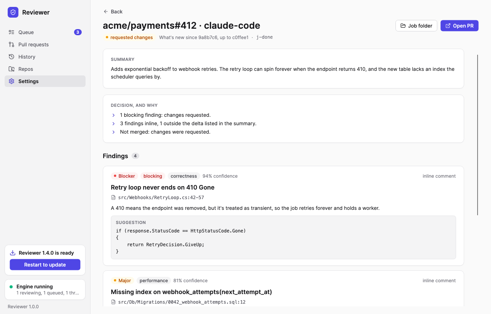
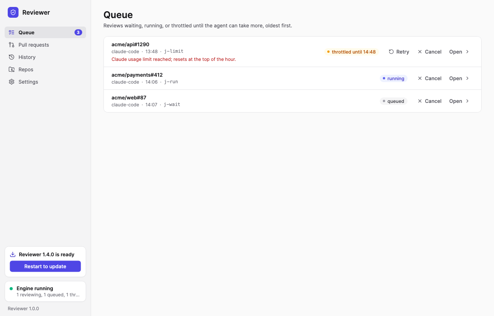
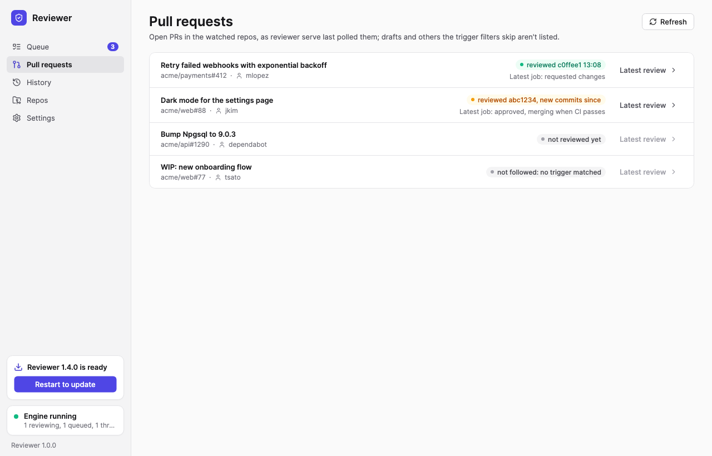
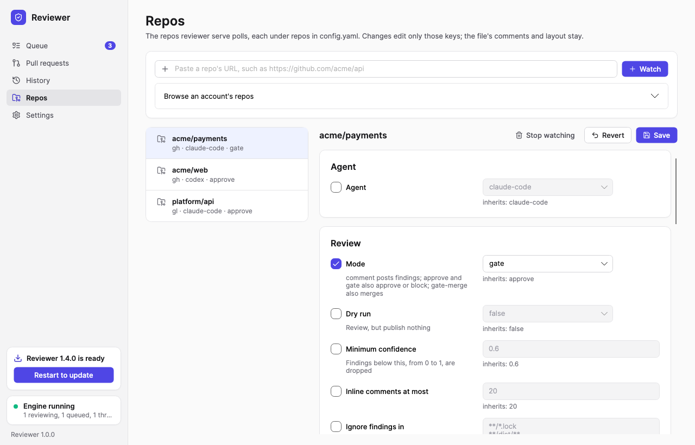
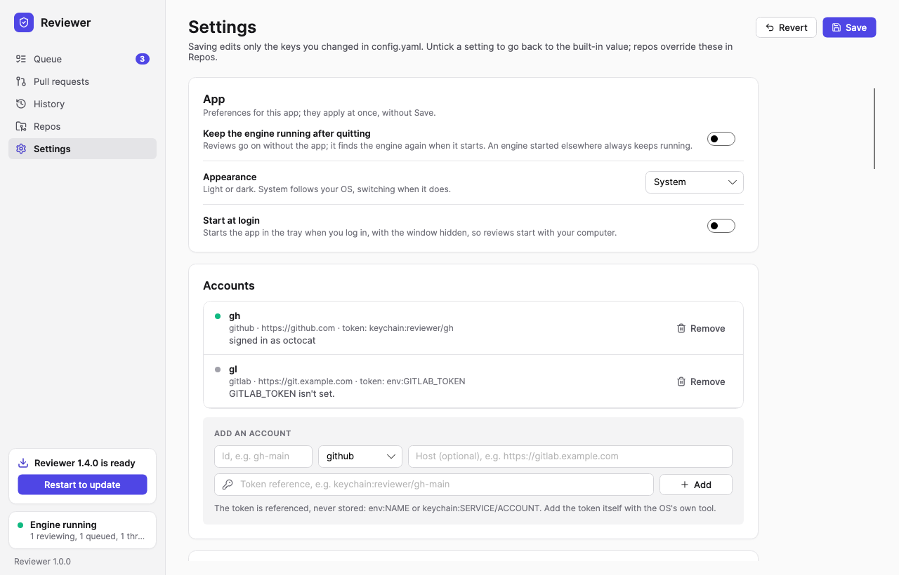

<div align="center">


# Reviewer

**A local-first AI code reviewer for GitHub and GitLab, running on your own machine and your own subscription.**

[](https://github.com/tez-Szymon/reviewer/releases)
[](#status)
[](https://github.com/tez-Szymon/reviewer/actions/workflows/ci.yml)
[](https://github.com/tez-Szymon/reviewer/actions/workflows/release.yml)
[](https://github.com/tez-Szymon/reviewer/releases)
<br>
[-lightgrey)](#install)
[](https://dotnet.microsoft.com/)
[](https://avaloniaui.net/)
[](#agents)
[](LICENSE)

[Download](https://github.com/tez-Szymon/reviewer/releases) · [Quick start](#quick-start) · [CLI](#cli) · [Configuration](#configuration) · [Architecture](docs/ARCHITECTURE.md)

<br>

<picture>
  <source media="(prefers-color-scheme: dark)" srcset="docs/images/Review-dark.png">
  
</picture>

</div>

---

> [!NOTE]
> **Reviewer 0.1.0 is a release candidate.** The review loop is used daily, but installers aren't signed with a Developer ID or Authenticode certificate yet, and release candidates don't auto-update to the next release candidate. See [Known issues](#known-issues-in-the-release-candidate).

## Why Reviewer

- **The model reports, code decides.** The agent only produces structured findings. Approving, requesting changes and merging are decided by a deterministic policy engine that prompts and skills can't reach.
- **Local-first.** The engine runs on your machine, checks out PRs into local worktrees, and keeps its state in a local SQLite database. Nothing is hosted for you, and no code leaves your machine except to the agent you chose.
- **Your subscription.** Reviews run through Claude Code or Codex under your own plan, or through the Anthropic API with your key.
- **Reviews only what's new.** A re-review covers the commits since the last one, and resolves the threads of findings that were fixed.
- **Hands off when you want it.** `reviewer serve` polls your repos, queues reviews when trigger rules match, waits out usage limits, and can merge once the merge guards pass.

## Screenshots

| Queue | Pull requests |
|---|---|
| <picture><source media="(prefers-color-scheme: dark)" srcset="docs/images/Queue-dark.png"></picture> | <picture><source media="(prefers-color-scheme: dark)" srcset="docs/images/Pulls-dark.png"></picture> |
| **Repos** | **Settings** |
| <picture><source media="(prefers-color-scheme: dark)" srcset="docs/images/Repos-dark.png"></picture> | <picture><source media="(prefers-color-scheme: dark)" srcset="docs/images/Settings-dark.png"></picture> |

<sub>Screens rendered with sample data by <code>tests/Reviewer.Desktop.Tests/ScreenTests.cs</code>. The images follow your GitHub light or dark theme.</sub>

## Features

| | |
|---|---|
| **Platforms** | GitHub, GitLab.com and self-hosted GitLab |
| **Agents** | Claude Code, Codex (sandboxed to read the worktree only), Claude through the Anthropic API (read-only tools over the worktree) |
| **Review modes** | `comment` posts findings · `approve` also approves when nothing blocks · `gate` approves or requests changes · `gate-merge` also merges, or sets the platform to merge when CI passes |
| **Automation** | Repo polling with ETags, trigger rules, a persistent job queue, throttling on usage limits, delta re-reviews |
| **Desktop app** | Live queue, watched PRs, history, findings and decisions, repo and settings editors that keep `config.yaml`'s comments and layout, tray, start at login, auto-update |
| **Secrets** | Tokens are referenced, never stored: `env:NAME` or `keychain:SERVICE/ACCOUNT` (macOS Keychain, Windows Credential Manager, libsecret) |
| **Quality tracking** | `reviewer eval` scores reviews against an eval set of changes with known bugs and compares runs |

## Install

Download the latest release from **[Releases](https://github.com/tez-Szymon/reviewer/releases)**. The app is self-contained (no .NET needed) and ships with the `reviewer` CLI beside it.

| Platform | File |
|---|---|
| macOS, Apple silicon | `Reviewer-osx-arm64.dmg` or `Reviewer-osx-arm64-Setup.pkg` |
| macOS, Intel | `Reviewer-osx-x64.dmg` or `Reviewer-osx-x64-Setup.pkg` |
| Windows x64 | `Reviewer-win-x64-Setup.exe` (per user, no admin rights) |
| Any of the above, no installer | `Reviewer-<rid>-Portable.zip` |
| Linux | CLI only for now: [build from source](#build-from-source) |

<details>
<summary><b>macOS: "can't be opened" on first launch</b></summary>

The release candidate is signed ad hoc, not with a Developer ID, so Gatekeeper blocks the first launch. Open the app once, then go to **System Settings → Privacy & Security** and press **Open Anyway**. Or clear the quarantine flag:

```bash
xattr -dr com.apple.quarantine /Applications/Reviewer.app
```

</details>

<details>
<summary><b>Windows: SmartScreen warning</b></summary>

`Setup.exe` isn't signed yet. In the SmartScreen dialog, choose **More info → Run anyway**.

</details>

<details>
<summary><b>Put the CLI on your PATH</b></summary>

```bash
# macOS
sudo ln -sf /Applications/Reviewer.app/Contents/MacOS/reviewer /usr/local/bin/reviewer
```

On Windows the CLI is `reviewer.exe` in the app's install folder, `%LOCALAPPDATA%\Reviewer\current`.

</details>

## Quick start

**1. Sign in to an agent** (any one):

```bash
claude auth login          # Claude Code
codex login                # Codex 0.162 or later
export ANTHROPIC_API_KEY=… # Anthropic API (agents.default: anthropic-api)
```

**2. Give it a token.** GitHub: `GITHUB_TOKEN`, or just `gh auth login`. GitLab: a token with the `api` scope in `GITLAB_TOKEN`, plus an account in `config.yaml`. To keep tokens in the OS keychain instead, add the item with the platform's own tool and reference it as `token: keychain:reviewer/gh-main`:

```bash
security add-generic-password -s reviewer -a gh-main -U -w                     # macOS Keychain
cmdkey /generic:reviewer/gh-main /user:gh-main /pass                           # Windows Credential Manager
secret-tool store --label=reviewer/gh-main service reviewer account gh-main    # Linux (libsecret)
```

**3. Check and try it.**

```bash
reviewer status                                              # agent health and each account's sign-in
reviewer review https://github.com/acme/api/pull/7 --dry-run # review, show the plan, post nothing
reviewer review https://github.com/acme/api/pull/7           # post the review
```

**4. Let it run.** Add repos in the desktop app's **Repos** page (or under `repos:` in `config.yaml`) and keep the app open, or run the engine yourself:

```bash
reviewer serve   # poll repos, work the queue, serve the local API until Ctrl+C
reviewer watch   # in another terminal: follow job changes live
```

## CLI

```bash
reviewer review <url>                          # review a PR or MR; again later: only what's new
reviewer review <url> --full                   # review the whole PR again
reviewer review <url> --dry-run --agent codex  # try another agent without posting
reviewer review <url> --dry-run --min-confidence 0.4   # see what a lower threshold adds
reviewer queue add <url> [--dry-run] [--full]  # queue a review for the engine
reviewer queue                                 # queued, running and throttled jobs
reviewer queue cancel <job-id> | retry <job-id>
reviewer history --repo acme/api               # past reviews, newest first
reviewer show 20261030-1200                    # one review with its findings (id or unique start)
reviewer config validate                       # check config.yaml
reviewer config show acme/api                  # the merged settings a review of acme/api uses
reviewer eval [--case <id>] [--agent <id>]     # score the eval set, compare with the last run
```

## Configuration

Everything lives in `~/.reviewer` (or `REVIEWER_HOME`): `config.yaml`, `reviewer.db` with every job and its findings, the job folders with each agent's inputs and output, and one bare repository per reviewed repo. Without `config.yaml`, built-in defaults apply: `comment` mode, and Markdown skills from `~/.reviewer/skills/*.md`.

```yaml
defaults:
  review: { minConfidence: 0.5 }
accounts:
  - { id: gh-main, provider: github, token: keychain:reviewer/gh-main }
repos:
  - repo: acme/api
    overrides:
      review: { mode: gate }    # approve when nothing blocks, request changes otherwise
  - repo: acme/web
    agent: codex
```

The desktop app edits the same file, changing only the keys you touched. See [Configuration](docs/ARCHITECTURE.md#configuration) for every key.

<a id="agents"></a>

| Agent | Billed to | Set with |
|---|---|---|
| `claude-code` (default) | Your Claude plan | `claude auth login` |
| `codex` | Your ChatGPT plan | `codex login`, then `agents.default: codex`, a repo's `agent:`, or `--agent codex` |
| `anthropic-api` | Your Anthropic API key | `agents.anthropic-api.apiKey` or `ANTHROPIC_API_KEY` |

## Status

Reviewer has been tried on real PRs across public and private repositories, and has found bugs that earlier human and bot reviews missed. Release candidates are for early users; the 0.1.0 release follows once the exit criteria below are met.

| Milestone | Scope | Status |
|---|---|---|
| **M1** · Core review loop | GitHub adapter, worktrees, Claude Code, findings schema, policy engine |  |
| **M2** · Engine, automation | Config, polling, triggers, job queue, SQLite state, delta review, local API |  exit criterion (a week unattended) pending |
| **M3** · Desktop and GitLab | Avalonia app, GitLab (incl. self-hosted), Codex, OS keychain, `gate-merge` |  daily-driver exit criterion pending |
| **M4** · API agents, release | Anthropic API agent, installers, auto-update, eval set |  signing certificates pending |

### Known issues in the release candidate

- **Unsigned installers.** macOS builds are signed ad hoc and not notarized; Windows builds aren't signed. See [Install](#install) for getting past Gatekeeper and SmartScreen.
- **No updates between release candidates.** Installed apps update to full releases only. To move to a newer release candidate, install it by hand.
- **Linux** has the CLI and engine, but no desktop app package.

Found a problem? [Open an issue](https://github.com/tez-Szymon/reviewer/issues).

## Build from source

Requires the [.NET 10 SDK](https://dotnet.microsoft.com/download).

```bash
dotnet build Reviewer.slnx
dotnet test Reviewer.slnx
dotnet run --project src/Reviewer.Cli -- --help
dotnet run --project src/Reviewer.Desktop
```

Package the desktop app for one runtime (on macOS for `osx-*`, on Windows for `win-*`) into `artifacts/releases/<rid>`:

```bash
eng/package.sh 0.1.0 osx-arm64
```

Releases are built by pushing a `v*` tag; see [docs/RELEASING.md](docs/RELEASING.md). After changing the database model in `src/Reviewer.Engine/State`, add a migration:

```bash
dotnet tool restore
dotnet ef migrations add <Name> --project src/Reviewer.Engine --startup-project src/Reviewer.Engine --output-dir State/Migrations
```

To refresh the screenshots in this README:

```bash
REVIEWER_SCREENSHOTS="$PWD/docs/images" dotnet test tests/Reviewer.Desktop.Tests --filter "FullyQualifiedName~ScreenTests"
```

## Documentation

- [Architecture](docs/ARCHITECTURE.md): engine, providers, agents, policy engine, triggers, local API, storage and security
- [Releasing](docs/RELEASING.md): tags, release assets, signing secrets, testing updates locally
- [Eval set](eval/README.md): how reviews are scored against known bugs

## License

Copyright © 2026 Szymon Bakunowicz. All rights reserved. This repository is public for visibility only; no license is granted. See [LICENSE](LICENSE).
